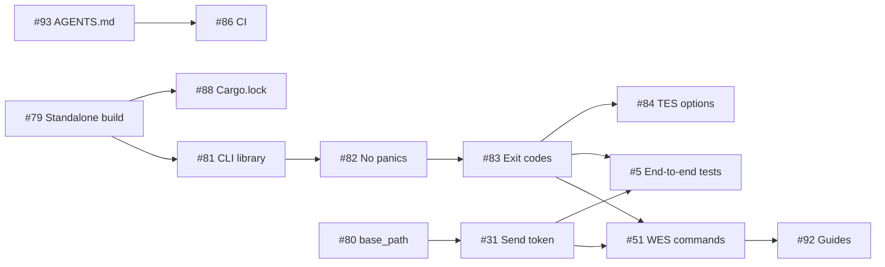

# Plan

The work is split into four tiers, and each item is an issue in [`ga4gh/ga4gh-sdk`](https://github.com/ga4gh/ga4gh-sdk). These docs refer to issues by number only. The state of each one is on the [project board](https://github.com/orgs/elixir-cloud-aai/projects/28).

## Scope

| Tier | What | For the event? |
|---|---|---|
| A | Fundamental fixes: without them, nothing reaches proTES | Target |
| B | Critical path: a CLI that scripts can use, tested end to end, and WES | Target |
| C | Nice to haves | [#93](https://github.com/ga4gh/ga4gh-sdk/issues/93), [#86](https://github.com/ga4gh/ga4gh-sdk/issues/86), [#88](https://github.com/ga4gh/ga4gh-sdk/issues/88) and [#92](https://github.com/ga4gh/ga4gh-sdk/issues/92) are target; the rest if time allows |
| D | Extensibility | After the event, unless time is left |

See [Tiers and issues](tiers.md) for each item, and the [Acceptance test](acceptance.md) for what "done" means.

## Order

Tier isn't order: [#93](https://github.com/ga4gh/ga4gh-sdk/issues/93), [#86](https://github.com/ga4gh/ga4gh-sdk/issues/86) and [#88](https://github.com/ga4gh/ga4gh-sdk/issues/88) are in tier C by importance, but they run first, as they give everyone else a gate to work against.

`cli/src/main.rs` is one file that nearly every CLI item touches, so those items run one at a time until [#81](https://github.com/ga4gh/ga4gh-sdk/issues/81) has split it. After that, service modules can run in parallel.

The work runs in parallel lanes. Nothing here should have two people on the same file or the same merge step.

| Lane | Issues | Notes |
|---|---|---|
| Setup | [#93](https://github.com/ga4gh/ga4gh-sdk/issues/93), then [#86](https://github.com/ga4gh/ga4gh-sdk/issues/86) (its `cargo fmt` commit first), then [#88](https://github.com/ga4gh/ga4gh-sdk/issues/88) after [#79](https://github.com/ga4gh/ga4gh-sdk/issues/79) | Start here |
| Transport | [#80](https://github.com/ga4gh/ga4gh-sdk/issues/80), then [#31](https://github.com/ga4gh/ga4gh-sdk/issues/31) | The core of the main goal |
| CLI | [#79](https://github.com/ga4gh/ga4gh-sdk/issues/79), [#81](https://github.com/ga4gh/ga4gh-sdk/issues/81), [#82](https://github.com/ga4gh/ga4gh-sdk/issues/82), [#83](https://github.com/ga4gh/ga4gh-sdk/issues/83), [#84](https://github.com/ga4gh/ga4gh-sdk/issues/84), [#51](https://github.com/ga4gh/ga4gh-sdk/issues/51), in sequence | [#82](https://github.com/ga4gh/ga4gh-sdk/issues/82) and [#83](https://github.com/ga4gh/ga4gh-sdk/issues/83) also touch `lib/src/utils`: coordinate with the transport lane. [#89](https://github.com/ga4gh/ga4gh-sdk/issues/89), [#61](https://github.com/ga4gh/ga4gh-sdk/issues/61), [#62](https://github.com/ga4gh/ga4gh-sdk/issues/62) and [#57](https://github.com/ga4gh/ga4gh-sdk/issues/57) are then independent of each other |
| End to end | [#5](https://github.com/ga4gh/ga4gh-sdk/issues/5) | After [#31](https://github.com/ga4gh/ga4gh-sdk/issues/31) and [#83](https://github.com/ga4gh/ga4gh-sdk/issues/83) |
| Independent | Library part of [#85](https://github.com/ga4gh/ga4gh-sdk/issues/85); library clients of [#89](https://github.com/ga4gh/ga4gh-sdk/issues/89) and [#61](https://github.com/ga4gh/ga4gh-sdk/issues/61); [#92](https://github.com/ga4gh/ga4gh-sdk/issues/92) once [#51](https://github.com/ga4gh/ga4gh-sdk/issues/51) is merged; [#94](https://github.com/ga4gh/ga4gh-sdk/issues/94) if time is left | |

The critical path is [#80](https://github.com/ga4gh/ga4gh-sdk/issues/80) and [#31](https://github.com/ga4gh/ga4gh-sdk/issues/31), along with [#79](https://github.com/ga4gh/ga4gh-sdk/issues/79), [#81](https://github.com/ga4gh/ga4gh-sdk/issues/81), [#82](https://github.com/ga4gh/ga4gh-sdk/issues/82) and [#83](https://github.com/ga4gh/ga4gh-sdk/issues/83), then [#5](https://github.com/ga4gh/ga4gh-sdk/issues/5) and [#51](https://github.com/ga4gh/ga4gh-sdk/issues/51). Binaries on tags ([#91](https://github.com/ga4gh/ga4gh-sdk/issues/91)) come last, after the acceptance test passes.

## Out of scope for the event

These stay open, and aren't planned for the event:

- Profiles in the configuration ([#47](https://github.com/ga4gh/ga4gh-sdk/issues/47))
- Python bindings for WES, DRS and TRS ([#52](https://github.com/ga4gh/ga4gh-sdk/issues/52), [#58](https://github.com/ga4gh/ga4gh-sdk/issues/58), [#63](https://github.com/ga4gh/ga4gh-sdk/issues/63)), which should follow [#99](https://github.com/ga4gh/ga4gh-sdk/issues/99)
- wasm and JavaScript ([#6](https://github.com/ga4gh/ga4gh-sdk/issues/6), [#7](https://github.com/ga4gh/ga4gh-sdk/issues/7))
- Attested-TLS and the extensions manager ([#71](https://github.com/ga4gh/ga4gh-sdk/issues/71), [#72](https://github.com/ga4gh/ga4gh-sdk/issues/72), [#73](https://github.com/ga4gh/ga4gh-sdk/issues/73), [#64](https://github.com/ga4gh/ga4gh-sdk/issues/64))
- Other TES implementations ([#15](https://github.com/ga4gh/ga4gh-sdk/issues/15))
- Generating models in Docker ([#43](https://github.com/ga4gh/ga4gh-sdk/issues/43))
- Coverage, pre-commit and repository templates ([#87](https://github.com/ga4gh/ga4gh-sdk/issues/87)), if time allows

The login with the OIDC device flow ([#90](https://github.com/ga4gh/ga4gh-sdk/issues/90)) is deferred: `GA4GH_TOKEN` ([#31](https://github.com/ga4gh/ga4gh-sdk/issues/31)) is the way to pass a token meanwhile.
